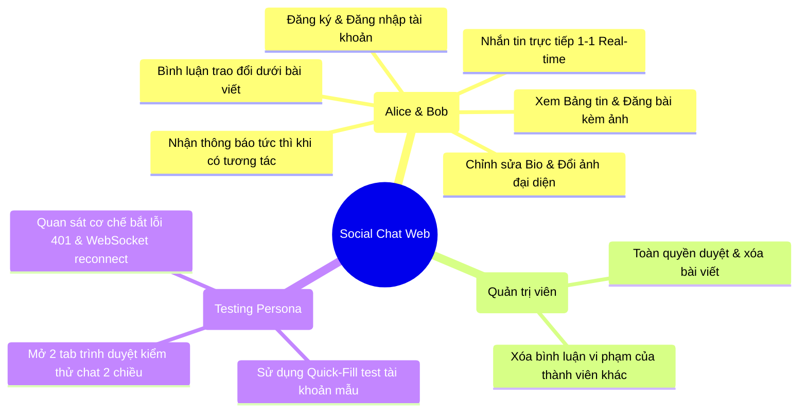
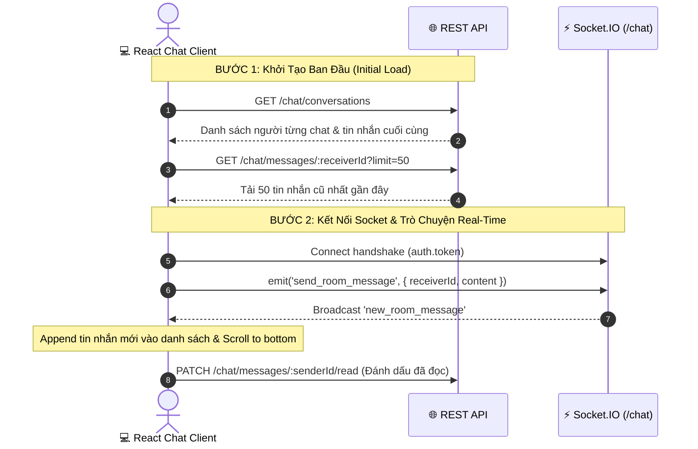

# Product Requirements Document (PRD) — Social Chat App Frontend

> **Dự án:** `nestjs-basic-course` — Capstone Project Web Client  
> **Tên sản phẩm:** Social Chat App Web Client (React Starter)  
> **Phiên bản:** 1.0 (Module 6 — Lesson 6.6)  
> **Trạng thái:** Sẵn sàng triển khai (Ready for Implementation)  
> **Tài liệu tham chiếu:**
>
> - 📄 [`docs/frontend-integration-guide.md`](file:///Users/tanthanh/Documents/Project/nestjs-basic-course/docs/frontend-integration-guide.md)
> - 📄 [`docs/04-project-architecture-and-codebase.md`](file:///Users/tanthanh/Documents/Project/nestjs-basic-course/docs/04-project-architecture-and-codebase.md)
> - 📄 [`docs/swagger.json`](file:///Users/tanthanh/Documents/Project/nestjs-basic-course/docs/swagger.json)
> - 📄 [`frontend/src/types/api.generated.ts`](file:///Users/tanthanh/Documents/Project/nestjs-basic-course/frontend/src/types/api.generated.ts)

---

## 1. 🎯 Tổng Quan & Mục Tiêu Sản Phẩm (Executive Summary)

### 1.1 Bối Cảnh

Khóa học **"NestJS & TypeScript Thực Chiến"** đã hoàn thiện toàn bộ hệ sinh thái Backend mạnh mẽ bao gồm: Xác thực JWT & OAuth2, Phân quyền RBAC, Quản lý CSDL PostgreSQL với Prisma 7, Phân trang Newsfeed (Offset & Cursor), Upload Media Multer, Hệ thống sự kiện Decoupled EventEmitter2, và Cổng WebSockets Gateway thời gian thực (Socket.IO).

Để hoàn tất bức tranh Full-Stack và mang lại trải nghiệm trực quan nhất cho học viên (Pedagogical Value), dự án cần một **Giao diện Web Frontend (React UI Client)** hoạt động hoàn chỉnh, kết nối đồng bộ 100% với bộ API backend hiện có.

### 1.2 Mục Tiêu Cốt Lõi (Core Objectives)

1. **Showcase Full-Stack Capabilities:** Biến toàn bộ các API lý thuyết thành giao diện người dùng thực tế có thể tương tác, đăng bài, bình luận và trò chuyện tức thì.
2. **Minh Họa Kiến Trúc Lai (Hybrid Architecture):** Thể hiện rõ nét sự phối hợp giữa **HTTP REST API** (tải dữ liệu ban đầu, CRUD) và **WebSockets Socket.IO** (đồng bộ tin nhắn và thông báo thời gian thực).
3. **Developer-Friendly & Testable:** Tích hợp sẵn thanh công cụ chuyển đổi nhanh tài khoản mẫu (Alice / Bob / Admin) giúp việc kiểm thử tính năng Chat 2 chiều diễn ra chỉ với 1 cú click chuột.
4. **Clean & Modern Aesthetic:** Giao diện phẳng hiện đại, tinh gọn (Clean Modern UI), chuẩn Responsive, sử dụng bảng màu trang nhã (Indigo / Slate).

---

## 2. 👥 Chân Dung Người Dùng & Trường Hợp Sử Dụng (User Personas)



---

## 3. 🗺️ Sơ Đồ Cấu Trúc Thông Tin & Điều Hướng (Information Architecture)

```mermaid
flowchart TD
    Root([Khởi Động Ứng Dụng]) --> AuthCheck{Đã Đăng Nhập?}

    AuthCheck -- Chưa --> AuthLayout[Auth View]
    AuthLayout --> Login[/login: Đăng nhập + Quick Fill/]
    AuthLayout --> Register[/register: Đăng ký tài khoản/]

    AuthCheck -- Đã có Token --> MainLayout[App Master Layout]

    subgraph Shell ["Khung Điều Hướng Chính (Top Navbar & Header)"]
        Logo[Brand Logo & Home Link]
        NavLinks[Bảng Tin / Tin Nhắn / Danh Bạ]
        NotifBell[Chuông Thông Báo + Unread Badge Real-time]
        UserMenu[Avatar + Tên + Logout]
    end

    MainLayout --> Shell
    Shell --> ViewFeed[/ (Newsfeed): Đăng bài, Cuộn tin, Bình luận/]
    Shell --> ViewChat[/chat: Danh sách hội thoại + Khung chat trực tiếp/]
    Shell --> ViewProfile[/profile: Xem & Cập nhật hồ sơ, Đổi avatar/]
    Shell --> ViewUser[/users/:id: Xem hồ sơ công khai của bạn bè/]
```

---

## 4. 📋 Yêu Cầu Chức Năng Chi Tiết (Functional Requirements)

### FR-1: Phân Hệ Xác Thực & Phiên Làm Việc (Authentication & Session)

| Mã Yêu Cầu | Tên Chức Năng                          | Mô Tả Nghiệp Vụ & Hành Vi Giao Diện                                                                                                                          | API & Socket Liên Quan                          |
| :--------- | :------------------------------------- | :----------------------------------------------------------------------------------------------------------------------------------------------------------- | :---------------------------------------------- |
| **FR-1.1** | Đăng ký tài khoản                      | Form đăng ký gồm: Họ tên, Email, Mật khẩu (tối thiểu 6 ký tự). Kiểm tra tính hợp lệ trước khi submit. Báo lỗi nếu trùng email (409 Conflict).                | `POST /auth/register`                           |
| **FR-1.2** | Đăng nhập hệ thống                     | Form đăng nhập bằng Email & Mật khẩu. Khi thành công, lưu `access_token` và `user` vào `localStorage`, chuyển hướng về trang chủ `/`.                        | `POST /auth/login`                              |
| **FR-1.3** | Quick-Fill Tài Khoản Test              | Thanh công cụ gồm 3 nút: **[Alice (User)]**, **[Bob (User)]**, **[Admin]**. Bấm nút nào sẽ tự điền email/mật khẩu và tự động submit đăng nhập để test nhanh. | Dữ liệu Seed: `Password@123`                    |
| **FR-1.4** | Quản lý Phiên & Tự động Đính kèm Token | Mọi request qua Axios tự động đính kèm `Authorization: Bearer <token>`. Khởi tạo kết nối Socket.IO với token qua `auth.token`.                               | Axios Request Interceptor & `io(..., { auth })` |
| **FR-1.5** | Xử lý Hết hạn Phiên (401 Handler)      | Khi server trả về mã `401 Unauthorized`, tự động xóa token khỏi Storage, ngắt kết nối Socket và chuyển hướng về `/login`.                                    | Axios Response Interceptor                      |
| **FR-1.6** | Đăng xuất (Logout)                     | Nút đăng xuất tại Header: Xóa storage, ngắt kết nối Socket, xóa trạng thái người dùng trong store và quay về `/login`.                                       | `disconnectChatSocket()`                        |

---

### FR-2: Phân Hệ Hồ Sơ Cá Nhân & Danh Bạ (Users & Profile)

| Mã Yêu Cầu | Tên Chức Năng                       | Mô Tả Nghiệp Vụ & Hành Vi Giao Diện                                                                                                                                               | API Liên Quan                                    |
| :--------- | :---------------------------------- | :-------------------------------------------------------------------------------------------------------------------------------------------------------------------------------- | :----------------------------------------------- |
| **FR-2.1** | Xem hồ sơ cá nhân                   | Trang `/profile` hiển thị: Avatar lớn, Họ tên, Email, Vai trò (`USER` / `ADMIN`), Tiểu sử (Bio), Địa điểm (Location).                                                             | `GET /users/profile`                             |
| **FR-2.2** | Cập nhật thông tin hồ sơ            | Cho phép chỉnh sửa Họ tên, Bio và Location. Hiển thị Toast thông báo khi cập nhật thành công.                                                                                     | `PATCH /users/profile`                           |
| **FR-2.3** | Tải lên & Đổi ảnh đại diện          | Nút tải ảnh đại diện (hỗ trợ JPG, PNG, WEBP, tối đa 2MB). Hiển thị Preview ảnh ngay lập tức. Sau khi upload thành công, cập nhật avatar trên Header và hồ sơ.                     | `POST /users/avatar` (multipart field: `avatar`) |
| **FR-2.4** | Danh bạ thành viên (User Directory) | Danh sách thành viên trong hệ thống (tự loại trừ tài khoản đang đăng nhập). Hỗ trợ ô tìm kiếm theo tên hoặc email. Có nút "Nhắn tin" để chuyển nhanh vào phòng chat với người đó. | `GET /users?search=&limit=`                      |
| **FR-2.5** | Xem hồ sơ công khai                 | Bấm vào avatar hoặc tên của bất kỳ tác giả nào trên bài viết sẽ chuyển đến xem trang cá nhân công khai của họ.                                                                    | `GET /users/:id`                                 |

---

### FR-3: Phân Hệ Bảng Tin Xã Hội & Bình Luận (Social Newsfeed & Comments)

| Mã Yêu Cầu | Tên Chức Năng                        | Mô Tả Nghiệp Vụ & Hành Vi Giao Diện                                                                                                                                              | API Liên Quan                                |
| :--------- | :----------------------------------- | :------------------------------------------------------------------------------------------------------------------------------------------------------------------------------- | :------------------------------------------- |
| **FR-3.1** | Khung tạo bài viết mới               | Ô nhập tiêu đề, nội dung bài viết, công tắc công khai (`published: true`). Hỗ trợ chọn tối đa 5 file ảnh đính kèm có preview thumbnail và nút xóa ảnh trước khi đăng.            | `POST /posts/upload-images`<br>`POST /posts` |
| **FR-3.2** | Bảng tin cuộn vô tận (Infinite Feed) | Hiển thị danh sách bài viết sắp xếp theo thời gian mới nhất. Áp dụng Cursor pagination: khi cuộn đến cuối trang, tự động gọi API lấy trang tiếp theo mà không gây giật màn hình. | `GET /posts/feed?cursor=&take=10`            |
| **FR-3.3** | Thẻ bài viết (Post Card)             | Hiển thị: Avatar, tên tác giả, nhãn thời gian tương đối ("vừa xong", "15 phút trước"), tiêu đề, nội dung văn bản, bộ sưu tập ảnh (Grid layout), nút Thảo luận/Bình luận.         | Dữ liệu bài viết                             |
| **FR-3.4** | Xóa bài viết                         | Nút thùng rác chỉ hiển thị với chính tác giả của bài viết hoặc người dùng có vai trò `ADMIN`. Yêu cầu xác nhận (Confirm modal) trước khi xóa.                                    | `DELETE /posts/:id`                          |
| **FR-3.5** | Xem & Cuộn danh sách bình luận       | Bấm vào nút bình luận trên Post Card sẽ mở rộng danh sách bình luận. Hỗ trợ nút "Xem thêm bình luận cũ hơn" (Cursor pagination).                                                 | `GET /posts/:postId/comments`                |
| **FR-3.6** | Thêm bình luận tức thì               | Form nhập nội dung bình luận dưới bài viết. Khi nhấn gửi, thêm bình luận vào danh sách hiển thị ngay lập tức (Tự động kích hoạt bắn sự kiện Notification trên server).           | `POST /posts/:postId/comments`               |
| **FR-3.7** | Xóa bình luận                        | Tác giả bình luận, chủ bài viết hoặc ADMIN có quyền xóa bình luận.                                                                                                               | `DELETE /comments/:id`                       |

---

### FR-4: Phân Hệ Trò Chuyện Thời Gian Thực (Hybrid Real-Time Chat)



| Mã Yêu Cầu | Tên Chức Năng                        | Mô Tả Nghiệp Vụ & Hành Vi Giao Diện                                                                                                                                                                         | API & Socket Liên Quan                    |
| :--------- | :----------------------------------- | :---------------------------------------------------------------------------------------------------------------------------------------------------------------------------------------------------------- | :---------------------------------------- |
| **FR-4.1** | Sidebar Hội thoại & Danh bạ          | Cột bên trái hiển thị danh sách các cuộc hội thoại gần đây (Avatar, Tên đối tác, Đoạn trích tin nhắn cuối, Thời gian, Badge số tin chưa đọc). Có Tab chuyển sang xem nhanh toàn bộ Danh bạ thành viên.      | `GET /chat/conversations`<br>`GET /users` |
| **FR-4.2** | Cửa sổ Chat Active (Chat Window)     | Header hiển thị thông tin đối tác chat và trạng thái kết nối WebSockets (Chấm xanh: Sẵn sàng).                                                                                                              | State Active Partner                      |
| **FR-4.3** | Tải lịch sử tin nhắn ban đầu         | Khi bấm chọn một người bạn, tự động gọi REST API để tải 50 tin nhắn gần nhất. Hiển thị hiệu ứng tải (Loading spinner).                                                                                      | `GET /chat/messages/:receiverId`          |
| **FR-4.4** | Bong bóng tin nhắn (Message Bubbles) | Phân biệt rõ ràng: Tin nhắn của mình (căn phải, nền màu nổi Indigo/Blue), Tin nhắn của bạn bè (căn trái, nền xám Slate, kèm Avatar). Hiển thị giờ gửi chính xác.                                            | Styling UI                                |
| **FR-4.5** | Gửi tin nhắn tức thì                 | Ô nhập nội dung tin nhắn, bấm nút Send hoặc gõ Enter để gửi. Phát sự kiện WebSocket `send_room_message`.                                                                                                    | Socket emit: `send_room_message`          |
| **FR-4.6** | Tiếp nhận tin nhắn mới Real-time     | Lắng nghe sự kiện `new_room_message`: Nếu tin nhắn thuộc cuộc hội thoại đang mở, tự động đẩy vào danh sách và cuộn xuống đáy (Auto-scroll to bottom). Nếu thuộc người khác, tăng số tin chưa đọc ở Sidebar. | Socket on: `new_room_message`             |
| **FR-4.7** | Đánh dấu đã đọc tin nhắn             | Khi mở một cuộc trò chuyện, tự động gửi request đánh dấu đã đọc toàn bộ tin nhắn từ người gửi này.                                                                                                          | `PATCH /chat/messages/:senderId/read`     |
| **FR-4.8** | Tham gia phòng chat nhóm (Room Chat) | Cho phép nhập Room ID (ví dụ: `general`, `tech_dev`) để tham gia phòng chat chung và trò chuyện cùng nhiều thành viên.                                                                                      | Socket emit: `join_room`, `leave_room`    |

---

### FR-5: Phân Hệ Thông Báo Trực Tuyến (Live Notifications)

| Mã Yêu Cầu | Tên Chức Năng                 | Mô Tả Nghiệp Vụ & Hành Vi Giao Diện                                                                                                                                | API & Socket Liên Quan                                             |
| :--------- | :---------------------------- | :----------------------------------------------------------------------------------------------------------------------------------------------------------------- | :----------------------------------------------------------------- |
| **FR-5.1** | Chuông thông báo trên Header  | Biểu tượng chuông kèm số Badge màu đỏ đếm số thông báo chưa đọc. Tải danh sách khi bấm vào chuông.                                                                 | `GET /notifications`                                               |
| **FR-5.2** | Lắng nghe thông báo Real-time | Socket tự động emit `subscribe_notifications` sau khi kết nối. Khi có sự kiện `new_notification`, chuông lập tức tăng số đếm và hiển thị Toast alert góc màn hình. | Socket on: `new_notification`                                      |
| **FR-5.3** | Đánh dấu thông báo đã đọc     | Cho phép bấm vào từng thông báo để đánh dấu đã đọc hoặc bấm "Đánh dấu tất cả đã đọc".                                                                              | `PATCH /notifications/read-all`<br>`PATCH /notifications/:id/read` |

---

## 5. ⚡ Yêu Cầu Phi Chức Năng (Non-Functional Requirements — NFR)

### 5.1 Hiệu Năng & Độ Trễ (Performance & Latency)

- **Thời gian tải trang khởi đầu (First Contentful Paint):** Dưới `1.2 giây` trên kết nối mạng tiêu chuẩn.
- **Độ trễ truyền tin nhắn Real-time:** Tin nhắn phát đi qua WebSocket hiển thị trên màn hình người nhận trong vòng `< 100ms`.
- **Trải nghiệm cuộn Bảng tin (Smooth Scrolling):** Không bị khựng hình (Jank-free 60fps) khi cuộn feed và nạp thêm trang mới nhờ cơ chế Cursor-based caching.

### 5.2 Trải Nghiệm Người Dùng (UX & Aesthetics)

- **Design System:** Thiết kế theo phong cách phẳng hiện đại (Clean Minimalist Tech UI), bo góc nhẹ nhàng (`rounded-xl`), hiệu ứng chuyển động vi mô (Micro-animations) mượt mà khi hover và bấm nút.
- **Trạng thái giao diện đầy đủ (Complete UI States):**
  - **Loading States:** Sử dụng Skeleton loader (khung xương xám nhấp nháy) thay vì màn hình trắng.
  - **Empty States:** Khi hòm thư chưa có tin nhắn hoặc bảng tin chưa có bài viết, hiển thị hình minh họa và câu kêu gọi hành động thân thiện ("Chưa có bài viết nào. Hãy là người đầu tiên chia sẻ!").
  - **Error Feedback:** Hiển thị thông báo lỗi rõ ràng qua Toast hoặc viền đỏ input khi nhập sai thông tin.

### 5.3 Khả Năng Thích Ứng (Responsive & Cross-Device)

- Hỗ trợ hoàn hảo từ màn hình máy tính để bàn (Desktop 1920x1080, 1440x900) đến máy tính bảng và điện thoại di động (Mobile 375px+).
- Trên Mobile, giao diện Chat hỗ trợ cơ chế chuyển đổi thông minh: Danh sách hội thoại ẩn đi khi mở khung chat và có nút "Quay lại" tiện lợi.

### 5.4 Bảo Mật Phía Client (Client-Side Security)

- Không bao giờ lưu trữ mật khẩu thuần (Plaintext password) trong LocalStorage hay State.
- XSS Protection: Mọi nội dung text nhập từ người dùng đều được React tự động escape khi render.
- Protected Routes: Không cho phép truy cập các URL nội bộ (`/`, `/chat`, `/profile`) nếu không có Bearer token hợp lệ.

---

## 6. 🛠️ Kiến Trúc Công Nghệ Phía Frontend (Technology Stack)

```text
┌─────────────────────────────────────────────────────────────┐
│                       PRESENTATION LAYER                    │
│   React 19 + TypeScript 5.7+ + Tailwind CSS + Lucide Icons   │
└──────────────────────────────┬──────────────────────────────┘
                               │
┌──────────────────────────────▼──────────────────────────────┐
│                    CLIENT STATE MANAGEMENT                  │
│       Zustand (Auth & Socket Store) + React Context         │
└──────────────────────────────┬──────────────────────────────┘
                               │
┌──────────────────────────────▼──────────────────────────────┐
│                     DATA & NETWORK LAYER                    │
│   Axios (HTTP Interceptors)  +  Socket.IO Client (v4.8)     │
│   Type Contracts: openapi-typescript (api.generated.ts)     │
└─────────────────────────────────────────────────────────────┘
```

| Thành phần                 | Công nghệ lựa chọn            | Lý do sử dụng                                                                             |
| :------------------------- | :---------------------------- | :---------------------------------------------------------------------------------------- |
| **Runtime & Build Tool**   | Node.js 22+ / Vite            | Khởi động server cực nhanh (<300ms), Hot Module Replacement (HMR) tức thì.                |
| **UI Library & Language**  | React 19 / TypeScript 5.7+    | Hệ sinh thái mạnh mẽ, Type-Safe đồng bộ 100% với Backend NestJS.                          |
| **CSS Framework**          | Tailwind CSS                  | Tùy biến giao diện hiện đại, tinh gọn dung lượng CSS bundle, hỗ trợ Dark/Light linh hoạt. |
| **Icons Library**          | `lucide-react`                | Bộ icon SVG nhẹ, hiện đại, phong phú phục vụ Social & Chat UI.                            |
| **HTTP Client**            | `axios`                       | Hỗ trợ Request/Response Interceptor bóc tách data envelope và xử lý lỗi tập trung.        |
| **WebSockets Client**      | `socket.io-client` (`^4.8.1`) | Tương thích hoàn hảo với `@nestjs/platform-socket.io` của backend.                        |
| **State Management**       | `zustand` (`^5.0.0`)          | Rất nhẹ (<1KB), cú pháp gọn gàng, hỗ trợ middleware `persist` lưu token vào localStorage. |
| **Type Safe Schema**       | `openapi-typescript`          | Tự động sinh kiểu dữ liệu từ `swagger.json`, ngăn chặn hoàn toàn việc gõ sai tên trường.  |
| **Thời Gian & Ngày Tháng** | `dayjs` hoặc `date-fns`       | Format thời gian đăng bài và gửi tin nhắn ("5 phút trước", "14:30").                      |

---

## 7. 📁 Cấu Trúc Mã Nguồn Chuẩn (Directory Architecture)

```text
frontend/
├── index.html
├── package.json
├── tsconfig.json
├── vite.config.ts
├── tailwind.config.js
├── .env.example                     # File cấu hình biến môi trường mẫu
│
└── src/
    ├── main.tsx                     # Điểm khởi chạy ứng dụng React
    ├── App.tsx                      # Root component, thiết lập Router & Toast Container
    ├── index.css                    # Cấu hình Tailwind directives & base styles
    │
    ├── api/                         # Khai báo các hàm gọi REST API phân theo domain
    │   ├── auth.api.ts              # login, register
    │   ├── users.api.ts             # getProfile, updateProfile, uploadAvatar, getUsers
    │   ├── posts.api.ts             # getFeed, createPost, uploadImages, deletePost
    │   ├── comments.api.ts          # getComments, createComment, deleteComment
    │   ├── chat.api.ts              # getConversations, getMessages, markAsRead
    │   └── notifications.api.ts     # getNotifications, markAllAsRead
    │
    ├── components/                  # Các thành phần giao diện tái sử dụng
    │   ├── common/                  # Nút bấm, Input, Modal, Avatar, Spinner, Badge
    │   ├── layout/                  # Navbar, Header, QuickFillBar, ProtectedRoute
    │   ├── posts/                   # PostCard, CreatePostBox, CommentSection, ImageGallery
    │   └── chat/                    # ConversationList, ChatWindow, MessageBubble, RoomModal
    │
    ├── stores/                      # Quản lý Global State với Zustand
    │   ├── auth.store.ts            # Quản lý token, thông tin user, login, logout
    │   └── chat.store.ts            # Quản lý danh sách tin nhắn, đối tác chat đang chọn
    │
    ├── services/                    # Tầng kết nối mạng lõi
    │   ├── api.ts                   # Cấu hình Axios instance & Interceptors unwrap envelope
    │   └── socket.ts                # Cấu hình Socket.IO client (/chat) & event emitter
    │
    ├── types/                       # Khai báo Type & Interfaces
    │   └── api.generated.ts         # Type tự động sinh từ OpenAPI (swagger.json)
    │
    └── utils/                       # Hàm tiện ích dùng chung
        ├── media.ts                 # Helper getMediaUrl (ghép VITE_ASSET_URL với đường dẫn ảnh)
        └── format.ts                # Helper format relative time ("10 phút trước")
```

---

## 8. 🚀 Kế Hoạch Triển Khai Chi Tiết (Phasing & Implementation Milestones)

Dự án được chia thành **5 Giai đoạn Triển khai (Milestones)** rõ ràng nhằm đảm bảo mỗi bước đi đều có thể chạy thử và kiểm chứng (Verify) ngay lập tức:

### Giai Đoạn 1: Thiết Lập Dự Án & Hạ Tầng Kết Nối Mạng (Scaffolding & Core Network)

- [x] Xuất OpenAPI Specification `swagger.json` từ Backend NestJS.
- [x] Tạo kiểu dữ liệu `frontend/src/types/api.generated.ts`.
- [ ] Khởi tạo dự án Vite React với Tailwind CSS và Lucide Icons.
- [ ] Cấu hình file `src/services/api.ts` với Axios Interceptors (tự unwrap `res.data.data` và tự gắn Bearer Token).
- [ ] Viết Module quản lý WebSockets `src/services/socket.ts` kết nối tới namespace `/chat`.
- [ ] Xây dựng `auth.store.ts` lưu trạng thái đăng nhập với LocalStorage persistence.

### Giai Đoạn 2: Xác Thực, Điều Hướng & Layout Shell (Auth & Master Shell)

- [ ] Dựng trang Đăng nhập (`/login`) và Đăng ký (`/register`).
- [ ] Tích hợp thanh công cụ **Quick-Fill Test Accounts** (Alice, Bob, Admin).
- [ ] Dựng khung Header chính: Brand Logo, Thanh điều hướng, Avatar người dùng, Nút Logout.
- [ ] Dựng cơ chế `ProtectedRoute` bảo vệ các trang nội bộ.

### Giai Đoạn 3: Bảng Tin Xã Hội & Tương Tác Bình Luận (Social Newsfeed & Comments)

- [ ] Xây dựng hộp tạo bài viết (`CreatePostBox`): Hỗ trợ chọn và preview danh sách ảnh đính kèm, upload qua `POST /posts/upload-images`.
- [ ] Xây dựng Bảng tin cuộn vô tận (`FeedPage`): Kết nối API `GET /posts/feed` với Cursor pagination.
- [ ] Xây dựng Thẻ bài viết (`PostCard`): Hiển thị avatar, tên tác giả, nội dung, lưới ảnh, thời gian tương đối.
- [ ] Xây dựng Luồng bình luận (`CommentSection`): Xem danh sách bình luận cũ và form gửi bình luận mới tức thì.

### Giai Đoạn 4: Hệ Thống Trò Chuyện Thời Gian Thực (Hybrid Real-Time Chat)

- [ ] Xây dựng trang Chat (`ChatPage`): Cột trái là danh sách cuộc trò chuyện gần nhất (`GET /chat/conversations`) và danh bạ thành viên (`GET /users`).
- [ ] Xây dựng Khung chat (`ChatWindow`): Khi chọn người bạn, tải lịch sử tin nhắn ban đầu qua REST `GET /chat/messages/:receiverId`.
- [ ] Lắp ráp cơ chế Socket gửi tin nhắn (`send_room_message`) và lắng nghe tin nhắn tức thì (`new_room_message`).
- [ ] Tự động cuộn xuống đáy khi có tin nhắn mới và gọi API đánh dấu đã đọc (`PATCH /chat/messages/:senderId/read`).

### Giai Đoạn 5: Thông Báo Trực Tuyến, Trang Cá Nhân & Hoàn Thiện (Live Notifs & Profile)

- [ ] Tích hợp Chuông thông báo trên Header: Lắng nghe sự kiện `new_notification`, hiển thị Toast alert và cập nhật số badge.
- [ ] Xây dựng Trang cá nhân (`ProfilePage`): Xem thông tin, form chỉnh sửa Bio/Location, upload và cập nhật Avatar mới (`POST /users/avatar`).
- [ ] Kiểm thử toàn diện 2 chiều (End-to-End Test): Mở 2 trình duyệt với Alice và Bob, tương tác bài viết và chat realtime thành công.

---

## 9. 🧪 Tiêu Chí Nghiệm Thu Sản Phẩm (Acceptance Criteria)

Sản phẩm được coi là **Đạt chuẩn Nghiệm thu (Done & Approved)** khi vượt qua toàn bộ các bài kiểm tra thực tế sau:

1. **Kiểm thử Đăng nhập & Quick-Fill:**
   - Bấm nút "Alice (User)" trên màn hình Login -> Tự động đăng nhập thành công và chuyển hướng vào Bảng tin.
   - Header hiển thị đúng tên "Alice" và ảnh đại diện.
2. **Kiểm thử Đăng bài & Upload Media:**
   - Alice đăng một bài viết kèm 2 bức ảnh -> Bài viết lập tức xuất hiện ở đầu Bảng tin với ảnh hiển thị sắc nét từ Backend static host (`http://localhost:3000/uploads/...`).
3. **Kiểm thử Chat Real-time 2 chiều (Hai cửa sổ trình duyệt):**
   - Mở Cửa sổ 1 (Alice) và Cửa sổ 2 Ẩn danh (Bob).
   - Cả 2 cùng vào trang `/chat`. Alice bấm vào Bob và gửi: _"Chào Bob, cậu có đó không?"_.
   - Khung chat của Bob lập tức xuất hiện tin nhắn của Alice trong vòng dưới 100ms mà không cần bấm F5 tải lại trang.
   - Bob phản hồi: _"Chào Alice, mình nhận được rồi nhé!"_ -> Khung chat của Alice lập tức cập nhật tin nhắn của Bob.
4. **Kiểm thử Thông báo Tức thời:**
   - Bob bình luận vào bài viết của Alice -> Màn hình của Alice lập tức hiện Toast thông báo _"Bob đã bình luận bài viết của bạn"_ và chuông thông báo nhảy số `+1`.
5. **Kiểm thử Đổi Ảnh đại diện:**
   - Alice vào trang `/profile`, chọn ảnh mới từ máy tính -> Upload thành công và Avatar mới lập tức cập nhật trên Header và khung chat.
