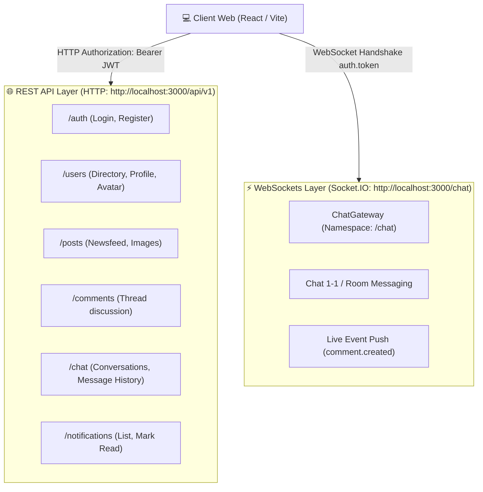
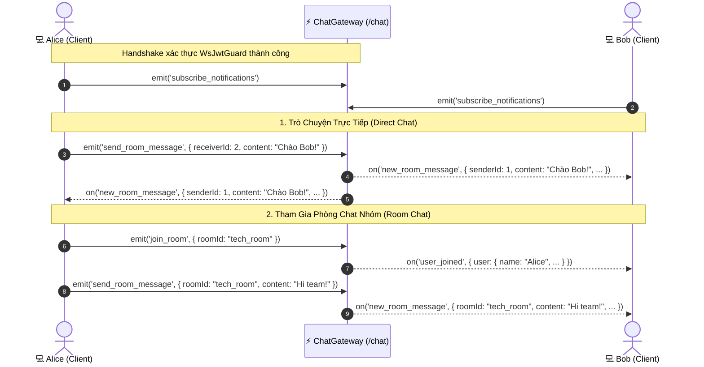

# Tài Liệu Hướng Dẫn Tích Hợp Frontend — Social Chat App

> **Dự án:** `nestjs-basic-course`  
> **Backend Stack:** NestJS 11, PostgreSQL, Prisma ORM 7, Socket.IO 4.8, JWT Auth  
> **API Version:** `/api/v1` | **Swagger UI:** `/api/docs` | **Swagger JSON:** `/api/docs-json`  
> **WebSocket Namespace:** `/chat`  
> **Target Audience:** Frontend Developers, Full-Stack Developers & AI Coding Agents  
> **Mục đích:** Cung cấp khế ước giao tiếp (API Contract), quy chuẩn mạng, mô hình dữ liệu và hướng dẫn tích hợp chi tiết để xây dựng giao diện Client (React / Vite) chuẩn xác 100%.

---

## 1. 🌐 Tổng Quan Kiến Trúc & Biến Môi Trường

Hệ thống hoạt động theo mô hình lai **Hybrid Architecture**:

- **Tầng REST API (Stateless - HTTP/HTTPS):** Đảm nhiệm Xác thực (Auth), Danh bạ (Users), Tải bài viết (Feed), Bình luận (Comments), Upload file và Lấy lịch sử hội thoại ban đầu.
- **Tầng WebSockets (Stateful - Socket.IO):** Đảm nhiệm Truyền nhận tin nhắn tức thời (Real-time Messaging), Trạng thái phòng chat và Bắn thông báo trực tiếp (Live Notifications).



### 1.1 Cấu Hình Môi Trường Frontend (`.env`)

Tạo file `.env` tại thư mục gốc của dự án Frontend:

```env
# Backend Base API URL (kèm prefix và versioning)
VITE_API_URL=http://localhost:3000/api/v1

# WebSockets Server URL (chỉ định chính xác Namespace /chat)
VITE_WS_URL=http://localhost:3000/chat

# Host tĩnh phục vụ Static Assets (Uploads Avatar, Post Images)
VITE_ASSET_URL=http://localhost:3000
```

### 1.2 Cấu Hình CORS trên Backend

Backend đã bật Cross-Origin Resource Sharing (CORS) cho phép mọi nguồn (`origin: true`) với `credentials: true`. Frontend không cần cấu hình proxy ngược nếu gọi trực tiếp qua URL trên.

---

## 2. 📦 Quy Chuẩn HTTP Request & Response Envelope

### 2.1 Cấu Trúc Phản Hồi Thành Công (Success Envelope)

Toàn bộ phản hồi HTTP thành công đều được chuẩn hóa bởi `TransformInterceptor` theo định dạng:

```typescript
interface ApiResponse<T> {
  statusCode: number; // HTTP Status Code (200, 201...)
  message: string; // Thông điệp phản hồi từ @ResponseMessage()
  data: T; // ⚠️ DỮ LIỆU THỰC SỰ NẰM Ở ĐÂY
  timestamp: string; // Thời gian ISO-8601
}
```

> [!IMPORTANT]
> **Quy Tắc Vàng Khi Gọi API:**
> Khi sử dụng Axios, dữ liệu trả về từ server sẽ nằm ở `response.data.data`.
> Bạn nên cấu hình Axios Response Interceptor để **tự động bóc tách** `response.data.data` (xem mục 4).

### 2.2 Cấu Trúc Phản Hồi Lỗi (Error Envelope)

Khi có lỗi (400 Bad Request, 401 Unauthorized, 404 Not Found, 409 Conflict...), `HttpExceptionFilter` và `PrismaClientExceptionFilter` trả về:

```typescript
interface ApiErrorResponse {
  statusCode: number;
  message: string | string[]; // Có thể là mảng string nếu lỗi từ Class-Validator
  error: string; // Tên mã lỗi (ví dụ: 'Bad Request', 'Unauthorized')
  timestamp: string;
  path: string; // Đường dẫn request bị lỗi
}
```

---

## 3. 🔐 Cơ Chế Xác Thực & Phân Quyền (Auth & RBAC)

### 3.1 Mặc Định Bảo Vệ Toàn Cục

Hệ thống sử dụng cơ chế bảo vệ mặc định: **MỌI ROUTE ĐỀU YÊU CẦU BEARER TOKEN**, trừ những route được gắn decorator `@Public()`.

Header bắt buộc cho mọi request bảo mật:

```http
Authorization: Bearer <jwt_access_token>
```

### 3.2 Danh Sách Endpoint Công Khai (`@Public()`)

Các endpoint này **không yêu cầu** header `Authorization`:

- `POST /api/v1/auth/register` — Đăng ký tài khoản mới.
- `POST /api/v1/auth/login` — Đăng nhập & lấy token.
- `GET /api/v1/auth/google` & `/api/v1/auth/google/callback` — Đăng nhập Google OAuth2.
- `GET /api/v1/posts` — Danh sách bài viết (Offset pagination).
- `GET /api/v1/posts/feed` — Newsfeed bài viết (Cursor pagination).
- `GET /api/v1/posts/:id` — Chi tiết bài viết.
- `GET /api/v1/posts/:postId/comments` — Danh sách bình luận dưới bài viết.
- `GET /api/v1/comments/:id` — Chi tiết bình luận.
- `GET /api/v1/users/:id` — Xem hồ sơ công khai của người dùng khác.

---

## 4. 🛠️ Cấu Hình Axios Client Chuẩn Mực

📄 **`frontend/src/services/api.ts`**

```typescript
import axios, { AxiosError, InternalAxiosRequestConfig } from "axios";

export const apiClient = axios.create({
  baseURL: import.meta.env.VITE_API_URL,
  headers: {
    "Content-Type": "application/json",
  },
});

// 1. Request Interceptor: Tự động đính kèm JWT Bearer Token
apiClient.interceptors.request.use(
  (config: InternalAxiosRequestConfig) => {
    const token = localStorage.getItem("access_token");
    if (token && config.headers) {
      config.headers.Authorization = `Bearer ${token}`;
    }
    return config;
  },
  (error) => Promise.reject(error),
);

// 2. Response Interceptor: Tự động bóc tách envelope { statusCode, message, data }
apiClient.interceptors.response.use(
  (response) => {
    // Nếu response có cấu trúc envelope chuẩn của NestJS, trả về thẳng data bên trong
    if (
      response.data &&
      "data" in response.data &&
      "statusCode" in response.data
    ) {
      return response.data.data;
    }
    return response.data;
  },
  (error: AxiosError<{ message?: string | string[]; error?: string }>) => {
    if (error.response?.status === 401) {
      // Token hết hạn hoặc không hợp lệ -> Xóa storage & chuyển hướng đăng nhập
      localStorage.removeItem("access_token");
      localStorage.removeItem("user_info");
      if (window.location.pathname !== "/login") {
        window.location.href = "/login";
      }
    }
    return Promise.reject(error);
  },
);
```

---

## 5. 📚 Chi Tiết Bộ REST API (Theo Từng Tính Năng)

> Toàn bộ kiểu dữ liệu (Types) đã được sinh tự động tại:  
> 📄 [frontend/src/types/api.generated.ts](file:///Users/tanthanh/Documents/Project/nestjs-basic-course/frontend/src/types/api.generated.ts)

### 5.1 Phân Hệ Xác Thực (`/auth`)

| Method | Endpoint         | Request Body                | Mô tả & Trả về                                                         |
| :----- | :--------------- | :-------------------------- | :--------------------------------------------------------------------- |
| `POST` | `/auth/register` | `{ email, password, name }` | Đăng ký tài khoản mới. Trả về thông tin User đã tạo.                   |
| `POST` | `/auth/login`    | `{ email, password }`       | Đăng nhập. Trả về `{ access_token, user: { id, email, name, role } }`. |

### 5.2 Phân Hệ Người Dùng & Hồ Sơ (`/users`)

| Method  | Endpoint         | Params / Body                | Mô tả & Trả về                                                                                                    |
| :------ | :--------------- | :--------------------------- | :---------------------------------------------------------------------------------------------------------------- |
| `GET`   | `/users`         | `?search=Alice&limit=50`     | **Danh bạ thành viên** (tự loại trừ tài khoản đang login). Dùng để hiển thị danh sách người có thể chat.          |
| `GET`   | `/users/profile` | _Không_                      | Lấy hồ sơ cá nhân đầy đủ của tài khoản hiện tại (`id, email, name, role, profile: { bio, avatarUrl, location }`). |
| `PATCH` | `/users/profile` | `{ name?, bio?, location? }` | Cập nhật họ tên, tiểu sử và vị trí.                                                                               |
| `POST`  | `/users/avatar`  | `FormData` (field: `avatar`) | Upload ảnh đại diện (JPG, PNG, WEBP <= 2MB). Trả về `{ url: '/uploads/avatars/...' }`.                            |
| `GET`   | `/users/:id`     | `Param: id` (number)         | Xem hồ sơ công khai của thành viên khác.                                                                          |

### 5.3 Phân Hệ Bảng Tin & Bài Viết (`/posts`)

| Method   | Endpoint               | Params / Body                         | Mô tả & Trả về                                                                                        |
| :------- | :--------------------- | :------------------------------------ | :---------------------------------------------------------------------------------------------------- |
| `GET`    | `/posts/feed`          | `?cursor=10&take=10&search=`          | **Newsfeed (Cursor Pagination)** phục vụ cuộn vô tận. Trả về danh sách bài viết kèm tác giả & avatar. |
| `GET`    | `/posts`               | `?page=1&limit=10&search=`            | Danh sách bài viết phân trang theo số trang truyền thống (Offset).                                    |
| `GET`    | `/posts/:id`           | `Param: id`                           | Xem chi tiết 1 bài viết kèm danh sách comments.                                                       |
| `POST`   | `/posts`               | `{ title, content, published: true }` | Tạo bài viết mới.                                                                                     |
| `PATCH`  | `/posts/:id`           | `{ title?, content?, published? }`    | Chỉnh sửa bài viết của chính mình.                                                                    |
| `DELETE` | `/posts/:id`           | `Param: id`                           | Xóa bài viết.                                                                                         |
| `POST`   | `/posts/upload-images` | `FormData` (field: `images`)          | Upload tối đa 5 file ảnh bài viết (mỗi file <= 5MB). Trả về `{ items: [{ url, ... }] }`.              |

### 5.4 Phân Hệ Bình Luận (`/comments`)

| Method   | Endpoint                  | Params / Body       | Mô tả & Trả về                                                 |
| :------- | :------------------------ | :------------------ | :------------------------------------------------------------- |
| `GET`    | `/posts/:postId/comments` | `?cursor=&limit=10` | Lấy danh sách bình luận dưới bài viết (Cursor pagination).     |
| `POST`   | `/posts/:postId/comments` | `{ content }`       | Thêm bình luận mới (Tự động kích hoạt thông báo cho chủ post). |
| `PATCH`  | `/comments/:id`           | `{ content }`       | Sửa nội dung bình luận.                                        |
| `DELETE` | `/comments/:id`           | `Param: id`         | Xóa bình luận (Chỉ tác giả, chủ bài viết hoặc ADMIN).          |

### 5.5 Phân Hệ Trò Chuyện REST (`/chat`)

| Method  | Endpoint                        | Params / Body                    | Mô tả & Trả về                                                                                                            |
| :------ | :------------------------------ | :------------------------------- | :------------------------------------------------------------------------------------------------------------------------ |
| `GET`   | `/chat/conversations`           | _Không_                          | Danh sách cuộc hội thoại gần đây của user: đối tác chat, tin nhắn gần nhất, thời gian và số tin chưa đọc (`unreadCount`). |
| `GET`   | `/chat/messages/:receiverId`    | `Param: receiverId`, `?limit=50` | Tải lịch sử tin nhắn ban đầu giữa mình và người nhận (để render giao diện trước khi nghe Socket).                         |
| `PATCH` | `/chat/messages/:senderId/read` | `Param: senderId`                | Đánh dấu đã đọc toàn bộ tin nhắn từ người gửi này.                                                                        |

### 5.6 Phân Hệ Thông Báo (`/notifications`)

| Method  | Endpoint                  | Params / Body               | Mô tả & Trả về                                                           |
| :------ | :------------------------ | :-------------------------- | :----------------------------------------------------------------------- |
| `GET`   | `/notifications`          | `?cursor=&limit=10&isRead=` | Danh sách thông báo (ví dụ: "Người khác đã bình luận bài viết của bạn"). |
| `PATCH` | `/notifications/read-all` | _Không_                     | Đánh dấu tất cả thông báo là đã đọc.                                     |
| `PATCH` | `/notifications/:id/read` | `Param: id`                 | Đánh dấu 1 thông báo cụ thể là đã đọc.                                   |

---

## 6. ⚡ Phân Hệ WebSockets Real-time (Socket.IO Contract)

### 6.1 Khởi Tạo Kết Nối & Xác Thực Handshake

Cổng WebSocket Gateway chạy tại:

- **Namespace:** `/chat` _(BẮT BUỘC, không dùng namespace mặc định `/`)_
- **Xác thực:** Bearer token truyền qua `client.handshake.auth.token`

📄 **`frontend/src/services/socket.ts`**

```typescript
import { io, Socket } from "socket.io-client";

let socket: Socket | null = null;

export const connectChatSocket = (token: string): Socket => {
  if (socket?.connected) return socket;

  socket = io(import.meta.env.VITE_WS_URL, {
    auth: {
      token: `Bearer ${token}`, // WsJwtGuard trích xuất token tại đây
    },
    transports: ["websocket", "polling"],
    autoConnect: true,
  });

  socket.on("connect", () => {
    console.log("🟢 Đã kết nối WebSockets Gateway /chat:", socket?.id);
    // Tự động đăng ký nhận thông báo real-time của chính mình
    socket?.emit("subscribe_notifications");
  });

  socket.on("connect_error", (err) => {
    console.error("🔴 Lỗi kết nối WebSocket:", err.message);
  });

  return socket;
};

export const disconnectChatSocket = () => {
  if (socket) {
    socket.disconnect();
    socket = null;
  }
};
```

### 6.2 Bảng Tra Cứu Sự Kiện WebSockets



#### A. Sự Kiện Client Gửi Lên Server (`emit`)

| Event Name                | Payload                                                     | Mô tả                                                                                                                               |
| :------------------------ | :---------------------------------------------------------- | :---------------------------------------------------------------------------------------------------------------------------------- |
| `subscribe_notifications` | _Không có (rỗng)_                                           | Đăng ký vào phòng `user_{userId}` để nhận thông báo thời gian thực khi có ai bình luận bài viết của mình.                           |
| `send_room_message`       | `{ receiverId?: number, roomId?: string, content: string }` | **Gửi tin nhắn:**<br>• Chat 1-1: truyền `receiverId: 2, content: "..."`<br>• Chat nhóm: truyền `roomId: "dev_team", content: "..."` |
| `join_room`               | `{ roomId: string }`                                        | Tham gia vào một phòng trò chuyện nhóm.                                                                                             |
| `leave_room`              | `{ roomId: string }`                                        | Rời khỏi phòng trò chuyện nhóm.                                                                                                     |
| `get_history`             | `{ receiverId: number, limit?: number }`                    | Lấy lịch sử qua socket (khuyến nghị dùng REST API thay thế).                                                                        |
| `ping`                    | _Không có_                                                  | Nhận phản hồi `'pong'` kiểm tra liveness.                                                                                           |

#### B. Sự Kiện Server Bắn Xuống Client (`on`)

| Event Name         | Dữ Liệu Nhận Được                                                                                                                             | Cách Xử Lý Trên UI                                                                                  |
| :----------------- | :-------------------------------------------------------------------------------------------------------------------------------------------- | :-------------------------------------------------------------------------------------------------- |
| `new_room_message` | `{ id: number, content: string, senderId: number, receiverId?: number, roomId?: string, createdAt: string, sender: { id, name, avatarUrl } }` | Thêm tin nhắn mới vào danh sách hiển thị trong khung chat và tự động cuộn xuống cuối (Auto-scroll). |
| `new_notification` | `{ id: number, title: string, content: string, isRead: false, createdAt: string }`                                                            | Tăng số đếm badge chuông thông báo (Unread Count) và hiển thị Toast alert.                          |
| `user_joined`      | `{ user: { userId, email, name } }`                                                                                                           | Hiển thị thông báo "Người dùng X đã tham gia phòng".                                                |
| `user_left`        | `{ user: { userId, email, name } }`                                                                                                           | Hiển thị thông báo "Người dùng X đã rời phòng".                                                     |

---

## 7. 🖼️ Xử Lý File Uploads & Đường Dẫn Media Tĩnh

Backend mount thư mục `uploads/` thành Static Assets công khai tại:
`http://localhost:3000/uploads/...`

### 7.1 Hàm Helper Chuẩn Hóa URL Ảnh

Vì Backend trả về đường dẫn tương đối (ví dụ: `/uploads/avatars/user-1.jpg`), Frontend cần hàm helper để render ảnh chính xác:

📄 **`frontend/src/utils/media.ts`**

```typescript
export function getMediaUrl(path?: string | null): string {
  if (!path) {
    return "https://ui-avatars.com/api/?background=6366f1&color=fff&name=User";
  }
  // Nếu là URL tuyệt đối từ faker hoặc bên ngoài
  if (path.startsWith("http://") || path.startsWith("https://")) {
    return path;
  }
  // Gắn Host URL tĩnh của Backend
  const assetHost = import.meta.env.VITE_ASSET_URL || "http://localhost:3000";
  return `${assetHost}${path.startsWith("/") ? path : "/" + path}`;
}
```

### 7.2 Code Mẫu Upload Avatar (Multipart Form-Data)

```typescript
import { apiClient } from "../services/api";

export async function uploadAvatar(file: File) {
  const formData = new FormData();
  formData.append("avatar", file); // Field name bắt buộc là 'avatar'

  // Axios tự động set 'Content-Type': 'multipart/form-data'
  const response = await apiClient.post<{ url: string }>(
    "/users/avatar",
    formData,
    {
      headers: { "Content-Type": "multipart/form-data" },
    },
  );
  return response; // Trả về { filename, size, mimetype, url }
}
```

---

## 8. 👥 Dữ Liệu Mẫu & Tài Khoản Kiểm Thử (Seed Accounts)

Để kiểm thử tính năng **Chat Real-time 2 chiều**, bạn hãy mở **2 cửa sổ trình duyệt** (1 Cửa sổ chính và 1 Cửa sổ Ẩn danh / Incognito) và đăng nhập với 2 tài khoản dưới đây:

| Tài khoản  | Email                  | Mật khẩu       | Vai trò | Chức năng test                                     |
| :--------- | :--------------------- | :------------- | :-----: | :------------------------------------------------- |
| **User A** | `alice@example.com`    | `Password@123` | `USER`  | Người gửi tin nhắn / Đăng bài viết                 |
| **User B** | `bob@example.com`      | `Password@123` | `USER`  | Người nhận tin nhắn / Bình luận bài viết           |
| **Admin**  | `admin@socialchat.com` | `Password@123` | `ADMIN` | Quản trị viên (xóa bài viết & kiểm tra phân quyền) |

> [!TIP]
> **Khởi tạo dữ liệu:**  
> Nếu cơ sở dữ liệu chưa có tài khoản trên, chạy lệnh sau ở Backend:
>
> ```bash
> pnpm prisma db seed
> ```

---

## 9. 📐 Cấu Trúc Thư Mục Frontend Khuyến Nghị

```text
frontend/src/
├── api/
│   ├── auth.api.ts          # login, register
│   ├── users.api.ts         # getProfile, updateProfile, uploadAvatar, getUsers
│   ├── posts.api.ts         # getFeed, createPost, uploadImages
│   ├── comments.api.ts      # getComments, createComment
│   ├── chat.api.ts          # getConversations, getMessages, markAsRead
│   └── notifications.api.ts # getNotifications, markAllAsRead
├── assets/                  # Logos, icons
├── components/
│   ├── common/              # Button, Input, Modal, Avatar, Toast
│   ├── layout/              # Navbar, Sidebar, NotificationBell
│   ├── posts/               # PostCard, CreatePostBox, CommentList
│   └── chat/                # ConversationList, ChatWindow, MessageBubble
├── contexts/ / stores/
│   ├── AuthContext.tsx      # Quản lý User info & Token
│   └── SocketContext.tsx    # Quản lý Socket instance & Real-time badge
├── pages/
│   ├── LoginPage.tsx        # Màn hình Đăng nhập (kèm nút chọn nhanh Alice/Bob)
│   ├── RegisterPage.tsx     # Màn hình Đăng ký
│   ├── FeedPage.tsx         # Bảng tin cuộn vô tận
│   ├── ChatPage.tsx         # Màn hình Chat (Sidebar + Khung chat active)
│   └── ProfilePage.tsx      # Xem & cập nhật thông tin cá nhân
├── services/
│   ├── api.ts               # Axios Client instance (Interceptor unwrap data)
│   └── socket.ts            # Socket.IO connection manager (/chat)
├── types/
│   └── api.generated.ts     # Type-Safe definitions sinh từ OpenAPI
└── utils/
    ├── media.ts             # getMediaUrl helper
    └── format.ts            # Format thời gian (date-fns / dayjs)
```

---

## 10. ✅ Checklist Kiểm Thử Tích Hợp (Verification Checklist)

Trước khi nghiệm thu bản build Frontend, đảm bảo các luồng sau hoạt động mượt mà:

- [ ] **Đăng nhập:** Đăng nhập thành công với `alice@example.com` / `Password@123` -> Lưu token vào `localStorage` -> Tự động chuyển hướng về `/`.
- [ ] **Tự động gắn Token:** Mọi API gọi sau đăng nhập đều có header `Authorization: Bearer <token>`.
- [ ] **Xử lý 401:** Thử xóa token trong Storage và bấm F5 -> Ứng dụng tự động điều hướng về `/login`.
- [ ] **Bảng tin Newsfeed:** Tải danh sách bài viết từ `GET /posts/feed` kèm Avatar tác giả hiển thị đúng URL tĩnh.
- [ ] **Bình luận & Sự kiện:** Alice bình luận dưới bài viết của Bob -> Bob (ở tab khác) nhận ngay Toast thông báo và chuông nhảy số (`new_notification`).
- [ ] **Trò chuyện 1-1:**
  - Alice mở chat với Bob -> Tải lịch sử cũ qua REST `GET /chat/messages/:bobId`.
  - Alice gõ tin nhắn và Enter -> Gửi qua Socket `send_room_message` -> Khung chat của Bob lập tức xuất hiện tin nhắn (`new_room_message`) không cần reload trang.
- [ ] **Upload Ảnh:** Đổi avatar thành công qua `POST /users/avatar` và cập nhật ngay lập tức trên Header.
